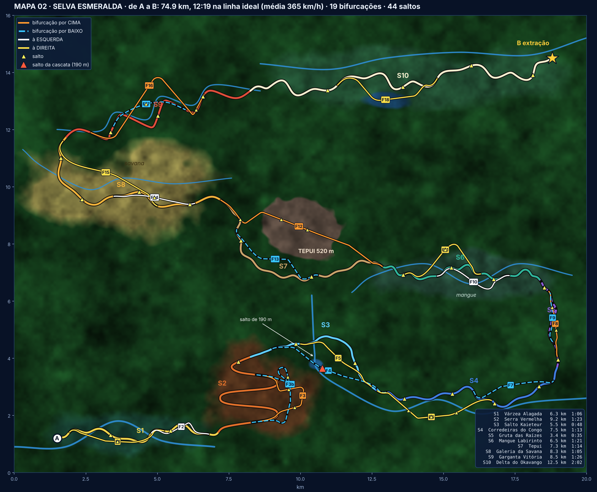
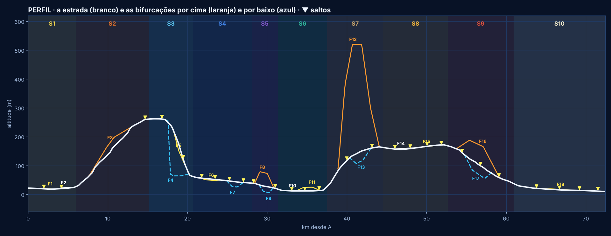
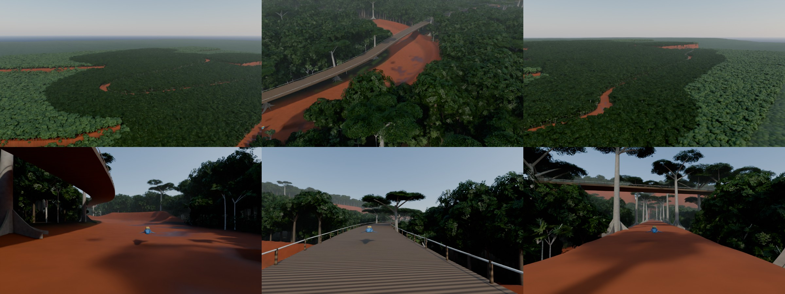
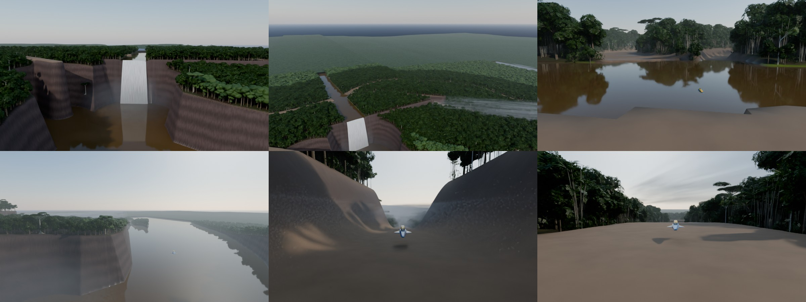
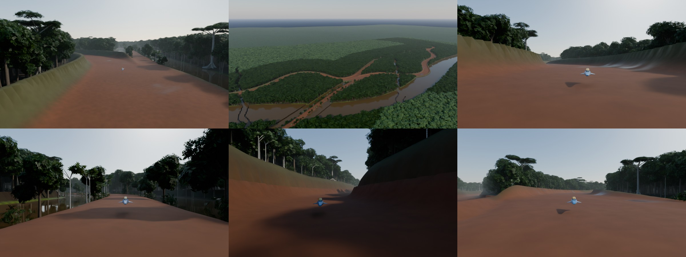

# Mapa 02 — Selva Esmeralda: o traçado (2026-11-02)

Pedido do jogador: "Vamos criar agora um mapa novo, com mais ou menos 12 a 13 minutos, um mapa de sobrevivência. A
temática não vai ser deserto nem Quénia: florestas, rios, África, Amazónia. Comecem pelo traçado. Muitas bifurcações,
muitas curvas, muitos saltos, bifurcações para cima, para baixo, para a esquerda e para a direita, até chegar a B."

**Este é só o traçado**, para o jogador aprovar. A seguir vem o terreno em Blender (secção 6).




## 1. Números

| | |
|---|---|
| A → B | **74,9 km** |
| Linha ideal | **12:19** (média de 365 km/h; 550 no máximo, 160-250 nas curvas mais apertadas) |
| Bifurcações | **19**: 4 por cima, 6 por baixo, 3 à esquerda, 6 à direita |
| Saltos | **43**: 27 na estrada e 16 nas bifurcações; o maior é a queda de 190 m da cascata |
| Mundo | 20 × 16 km, de A (delta a sudoeste) a B (delta a nordeste) |

Os meandros de cada setor nunca curvam mais apertado do que o setor permite: as ondas mais curtas encolhem primeiro e
depois a amplitude (antes ficavam curvas de 77 m na savana, que devia ser a parte mais rápida).

Usa o mesmo modelo do Red Dust Divide (`Scripts/sculpt_expedition_ab.py`):
- 550 km/h no máximo, e uma curva de 120 m faz-se a 200 km/h;
- acelera a 12 m/s² e trava a 30 m/s²;
- a gruta vai a 360 km/h no máximo, por causa da visibilidade.

Script: `python3 Scripts/selva/plan_selva.py` (planta, perfil e `Scripts/selva/selva_plano.json`).

## 2. Os 10 setores: Amazónia e África à vez

| Setor | Inspirado em | km | Tempo | Altitude | Carácter |
|---|---|---|---|---|---|
| **S1 Várzea Alagada** | Amazónia | 6,3 | 0:00-1:06 | 22-27 m | Partida no delta: floresta alagada, bancos de areia, meandros largos e rápidos |
| **S2 Serra Vermelha** | Congo | 9,2 | 1:06-2:30 | 27 → 261 m | Cinco pernas em zigue-zague pela serra de laterite vermelha, ganchos de ~150 m |
| **S3 Salto Kaieteur** | Guiana | 5,5 | 2:30-3:19 | 261 → 62 m | Pelo topo da serra até à beira de uma cascata gigante, depois a descida longa ao lado dela |
| **S4 Corredeiras do Congo** | Congo | 7,5 | 3:19-4:33 | 62 → 39 m | Ao longo do rio, rápidos e afluentes para saltar |
| **S5 Gruta das Raízes** | Amazónia | 3,4 | 4:33-5:08 | 39 → 18 m | Gruta larga debaixo de um monte segurado pelas raízes de sumaúmas, com clarabóias |
| **S6 Mangue Labirinto** | Delta do Níger / foz do Amazonas | 6,5 | 5:08-6:29 | 18 → 27 m | Curvas técnicas entre o mangue, canais para saltar |
| **S7 Tepui** | Roraima | 7,3 | 6:29-7:44 | 27 → 163 m | À volta da base de uma montanha de mesa de 520 m |
| **S8 Galeria da Savana** | Tanzânia / Zâmbia | 8,3 | 7:44-8:49 | 162-168 m | Savana aberta com embondeiros e acácias ao lado de uma floresta de galeria, muito rápida |
| **S9 Garganta Vitória** | Zâmbia / Zimbabué | 8,5 | 8:49-10:16 | 168 → 38 m | O desfiladeiro em zigue-zague abaixo das Cataratas Vitória |
| **S10 Delta do Okavango** | Botsuana | 12,5 | 10:16-12:19 | 37 → 10 m | Canais e ilhas do delta até à extração em B |

## 3. As 19 bifurcações

**Entradas e saídas em Y** (jogador, 2026-11-02: "estavam muito brutas; têm de abrir e fechar em Y, que se possa entrar
sem querer a alta velocidade"):
- **Abertura:** cada bifurcação nasce encostada à estrada, como a saída de uma autoestrada. Afasta-se aos poucos durante
  ~4 s de corrida (250-650 m), sem ângulo nenhum no início.
- **Separador:** começa como uma linha pintada, por isso ninguém bate no nariz da divisão.
- **Curvas:** entre os dois Y a bifurcação é "conduzida" e nunca curva mais apertado do que a velocidade a que se
  entra. Perto do Y o raio é de pelo menos v²/aderência (a 450 km/h, ~600 m).
- **Fecho:** fecha em Y da mesma maneira.
- **Onde:** cada Y fica num trecho direito da estrada. Um Y que calhasse dentro de uma curva fechada (o das Pontes da
  Copa caía dentro do primeiro gancho da serra) passa para antes dela, porque por dentro de uma curva a faixa do Y é
  mais apertada do que a própria estrada.
- **Velocidade:** quase todas se fazem a fundo, perdendo no máximo ~20 % à entrada. Depois do Y nenhuma bifurcação
  curva a menos de 110 m, e o fecho entra no Y de saída por uma curva larga.

**Ganho:** é o tempo que cada uma ganha (+) ou perde (−) contra a estrada. Cada bifurcação foi esticada ou encurtada
até valer o que o seu estilo pede:
- **SKILL**: arriscada, cerca de +5 s;
- **RACING**: a linha de corrida, cerca de +2,5 s;
- **SAFE**: segura, cerca de −4 s;
- **salto da cascata**: cerca de +10 s.

| | Tipo | Estilo | O que é | km (estrada) | Ganho |
|---|---|---|---|---|---|
| **F1 Igapó** | direita | RACING | pelo igapó: entre árvores dentro de água, rente à água | 3.5 (3.7) | +1.5 s |
| **F2 Banco de Areia** | esquerda | SAFE | banco de areia largo e rápido | 2.3 (2.2) | -3.6 s |
| **F3 Pontes da Copa** | **CIMA** | SKILL | pontes suspensas e troncos gigantes a 35 m do chão, sobe a serra a direito | 3.8 (5.6) | +4.4 s |
| **F3b Ravina das Sapopemas** | **BAIXO** | SAFE | o fundo de uma ravina por baixo das Pontes da Copa, entre as raízes das sumaúmas | 5.1 (6.2) | -3.2 s |
| **F4 Salto da Cascata** | **BAIXO** | RACING | pela beira do salto e lá para baixo: queda de 190 m para o lago do salto | 4.4 (5.1) | +8.5 s |
| **F5 Trilho da Névoa** | direita | SKILL | patamar estreito na névoa da cascata, corta por dentro da descida | 3.1 (3.5) | +4.6 s |
| **F6 Ilhas das Corredeiras** | direita | SKILL | saltos de ilha em ilha no meio das corredeiras | 4.5 (4.4) | +4.4 s |
| **F7 Leito Seco** | **BAIXO** | RACING | leito seco do rio, 18 m abaixo da margem | 3.1 (3.3) | +3.0 s |
| **F8 Raízes Gigantes** | **CIMA** | SKILL | por cima do monte da gruta, pelas raízes das sumaúmas | 2.3 (2.4) | +3.5 s |
| **F9 Rio Subterrâneo** | **BAIXO** | RACING | o andar de baixo da gruta, ao lado do rio subterrâneo | 1.8 (1.8) | +3.4 s |
| **F10 Canal Estreito** | esquerda | SKILL | canais apertados entre o mangue | 3.0 (2.9) | +4.7 s |
| **F11 Palafitas** | direita | SAFE | passadiço por cima da aldeia de palafitas, 12 m acima da água | 3.7 (3.1) | -3.7 s |
| **F12 Topo do Tepui** | **CIMA** | SKILL | rampa até ao topo (520 m), saltos entre blocos de rocha e mergulho de volta | 6.5 (7.7) | +7.8 s |
| **F13 Fenda do Tepui** | **BAIXO** | RACING | uma fenda dentro da base do tepui, 30 m abaixo | 3.7 (3.9) | +2.5 s |
| **F14 Savana Aberta** | esquerda | RACING | savana aberta, a mais de 500 km/h, termiteiras para saltar | 2.9 (3.1) | +3.2 s |
| **F15 Floresta de Galeria** | direita | SKILL | dentro da floresta de galeria, junto ao rio | 4.4 (5.4) | +4.7 s |
| **F16 Ponte do Comboio** | **CIMA** | RACING | a velha ponte do comboio por cima da garganta, 60-70 m acima: corta os zigue-zagues | 6.1 (5.7) | +2.4 s |
| **F17 Fundo da Garganta** | **BAIXO** | SKILL | o fundo da garganta, ao lado dos rápidos do Zambeze | 2.9 (3.5) | +4.7 s |
| **F18 Calçada do Lago** | direita | RACING | calçada a direito por cima do lago | 4.2 (4.1) | +1.1 s |

\* **F12:** o modelo de tempo não conta a subida de 440 m até ao topo, por isso o topo do tepui vale +8 s em vez dos
+5 s de uma SKILL (velocidade limitada pela rocha lá em cima). Volta à estrada já na savana, depois de mergulhar do
tepui.

Todas as bifurcações ficam a menos de 1,5 s do que o seu estilo pede.

**Três níveis ao mesmo tempo:**
- **Na gruta:** as raízes por cima (F8), a estrada no meio e o rio subterrâneo por baixo (F9).
- **Na serra:** as Pontes da Copa (F3) por cima, a estrada em zigue-zague no meio e a Ravina das Sapopemas (F3b)
  por baixo da ponte. A ponte passa por cima de um gancho da estrada e da ravina.
- **Na cascata:** há três escolhas: saltar (F4), a névoa (F5) ou descer pela estrada.

## 4. Os saltos (43)

**Na estrada (27):**

| Setor | Saltos |
|---|---|
| S1 | igarapé, tronco caído |
| S2 | crista da serra |
| S3 | laje da cascata, degrau da descida |
| S4 | 2 afluentes, 2 rápidos |
| S5 | boca e saída da gruta |
| S6 | 2 canais e uma raiz |
| S7 | talude, rampa de basalto |
| S8 | 2 termiteiras, rio de areia, lomba |
| S9 | 3 ressaltos do desfiladeiro |
| S10 | 3 canais do delta, ilha |

**Nas bifurcações (16):**

| Bifurcação | Saltos |
|---|---|
| F1 | raízes |
| F3 | ponte partida, tronco |
| F4 | **a queda de 190 m** |
| F6 | 3 ilhas |
| F8 | raiz, descida |
| F11 | cais |
| F12 | 2 fendas no topo, mergulho |
| F14 | termiteira |
| F16 | fim da ponte |
| F17 | rochedo |

## 5. Sobrevivência

A extração continua igual: quem é destruído perde a carga para o porquinho e só quem chega a B a leva
(`Docs/VISAO_JOGO.md`). A selva pode trazer perigos próprios, **por decidir com o jogador**:
- árvores que caem na estrada;
- cheias que fecham o Leito Seco (F7);
- névoa da cascata que tira a vista;
- chuva tropical que tira aderência;
- mais tarde, os monstros da visão: crocodilos e hipopótamos nos rios, enxames no mangue.

## 6. Terreno em Blender, peça por peça (2026-11-02)

Pedido do jogador: "vamos para o Blender fazer o mapa peça por peça". Cada setor é feito, fotografado e mostrado, e só
depois se passa ao seguinte.

```
blender -b -P Scripts/selva/sculpt_selva.py -- C:/rdd/selva S1 [res=3] [samples=40] [size=1600x900] [noshots] [only=aerea,...]
```

(na nuvem corre com `python3` e o módulo `bpy`.)

- **O kit da selva** (`Scripts/selva/jungle_kit.py`) é nosso, feito por código, sem assets de terceiros. As texturas
  das folhas também são pintadas por código. Tem:
  - sumaúma com sapopemas (as raízes em tábua) e copa em guarda-chuva;
  - três árvores do dossel;
  - touceira de açaí;
  - buriti com folhas em leque;
  - embaúba de tronco branco;
  - dois arbustos;
  - versões "ao longe" das árvores grandes, que são mais rápidas de desenhar.

  Nada tem colisão. `export_kit()` escreve os FBX para o Unreal.
- **Ficheiros para o Unreal** (como no Red Dust Divide):
  - `selva_<S>_height.r16` e `selva_<S>.json`: o relevo, com a caixa, os metros por píxel, as alturas, o nível da água,
    o perfil da estrada e os saltos;
  - `selva_<S>_props.json`: cada planta, com espécie, posição, rotação e escala.

### S1 Várzea Alagada (feito, por aprovar)

- **Água:** fica a 16 m, metro e meio abaixo do ponto mais baixo da estrada.
- **Floresta:** a cerca de um metro acima da água, com lagoas, o rio do delta (180 m de largura, com diques naturais
  nas margens) e oito igarapés a atravessar a floresta.
- **Estrada:** vai num aterro de areia por cima das lagoas e dos igarapés. Tem charcos e erva nas bermas, e a orla da
  floresta é uma parede verde (arbustos, açaí, embaúbas e árvores novas).
- **Vaus:** atravessa o rio em dois vaus (cerca de 520 m e 150 m), com a estrada 12 cm abaixo da água. As naves
  deslizam rente à água. No Unreal, a colisão é o chão por baixo da água.
- **Salto do igarapé (2,1 km):** uma rampa de 2,6 m até à margem e 32 m de água por cima.
- **Tronco caído (4,4 km):** uma rampa de areia de 3,2 m até ao tronco de uma sumaúma morta (48 m, com musgo), atravessado
  na estrada, e a queda do outro lado.
- **F1 Igapó:** ao nível da água, dentro da floresta alagada, com árvores dentro de água dos dois lados.
- **F2 Banco de Areia:** largo e em areia.
- **Números:** cerca de 87 mil plantas e 220 sumaúmas. Há sumaúmas "heroínas" a cada ~420 m, junto à estrada.

### S2 Serra Vermelha (feito, por aprovar)



- **Serra:** o chão é uma superfície lisa que passa pelas alturas da própria estrada, para cada perna do zigue-zague
  ficar no seu socalco. Longe da estrada há colinas, esporões e ravinas.
- **Estrada:** laterite vermelha. As bermas cortadas e os aterros mostram a terra vermelha à vista.
- **Pernas retas e ganchos semi-ovais** (jogador: "retas, com algumas partes semi-ovais"). Por fora de cada gancho
  ergue-se uma parede semi-oval de 12 m, como num velódromo. Cresce na curva e desaparece nas retas.
- **F3 Pontes da Copa:** onde vai a mais de 6 m do chão é uma ponte de tábuas com corrimão de corda. Está pendurada
  entre pares de sumaúmas a cada 70 m, com as copas logo por cima do tabuleiro, e passa por cima de um gancho da
  estrada.
  - **Ponte partida:** um impulso e 26 m sem tábuas.
  - **Tronco:** a ponte faz uma lomba por cima de um tronco atravessado.
- **F3b Ravina das Sapopemas** (jogador: "um na ponte e outro por baixo"): o terceiro caminho serra acima.
  - **Onde:** o fundo de uma ravina de paredes íngremes por baixo das pontes, entre sumaúmas plantadas nas bordas,
    com as sapopemas a descer até ao trilho.
  - **Salto:** uma raiz gigante atravessada no trilho.
  - **Traçado:** dá a volta por fora dos ganchos e nunca cruza a estrada.
  - **Estilo:** a via segura (SAFE, cerca de −3 s), ao lado da ponte arriscada e da estrada.
- **Salto da crista da serra:** uma lomba de 4 m no topo.
- **Números:** cerca de 154 mil plantas. A floresta é a do Congo, sem as palmeiras da Amazónia, com embaúbas
  (o *Musanga* africano é parecido).

### Em todos os setores: a estrada tem relevo natural e as árvores não ficam no caminho

- **Relevo da estrada** (jogador: "estrada muito plana; ondulações de lama, não em toda a estrada, natural, não
  esculpido; sem as naves andarem aos saltos"):
  - **Em toda a estrada:** ondas longas e baixas, de ±8 cm em ~30 m.
  - **Nas manchas de lama** (cerca de 40 % da estrada): ondas de ±22 cm e ondulações de lama de ±9 cm em ~11 m.
  - **Inclinação:** no máximo poucos por cento, e as almofadas acompanham.
  - **Charcos:** ficam nas covas.
  - **Bordas:** variam ±1,2 m.
  - **Nos vaus:** não há relevo.
- **Pilares-sumaúma da ponte:** nunca ficam em cima de uma estrada ou bifurcação no chão. Uma ficava no meio da
  ravina F3b, por baixo da ponte (o jogador viu-a nas fotos).

### S3 Salto Kaieteur (feito, por aprovar)



- **Planalto e rio:** o planalto do topo da serra tem um rio de 90-110 m de largura (água a 248,5 m).
- **Cascata:** o rio cai ~187 m da escarpa para um lago de 150 m de raio (água a 61,5 m). A queda é uma cortina
  branca arqueada pela própria velocidade, com névoa por cima do lago.
- **Garganta:** começa no lago com 90 m de fundo e alarga até 310 m. As falésias têm 76°, com a linha recortada,
  patamares e arenito em camadas com escorrências escuras. Não há árvores nas falésias.
- **Laje da cascata (salto, 17,8 km):** a estrada cruza o rio 360 m antes da beira. Tem uma rampa de 3 m na laje de
  pedra e salta o rio. O salto passou para este sítio no traçado.
- **Descida:** depois da laje, a estrada desce a encosta ao lado da garganta. Tem o **degrau da descida**: uma
  subida até uma beira e 6 m para baixo.
- **F4 Salto da Cascata:** vai pelo planalto até à beira, ao lado da cascata. Não há estrada no ar: a garganta
  abre-se por baixo do salto. Aterra no rio, lá em baixo, e segue pela margem até voltar à estrada.
- **F5 Trilho da Névoa:** um desfiladeiro estreito de arenito com névoa, que corta por dentro da descida.
- **Números:** cerca de 117 mil plantas: floresta da Guiana, com açaí e buriti.

### S4 Corredeiras do Congo (feito, por aprovar)



- **Estradas ovais** (jogador: "acabou com as estradas artificiais; quero ovais que permitem ultrapassar pelas paredes
  a alta velocidade; as paredes ficam pequenas à medida que se avança, vales pequenos"):
  - **Paredes:** há uma parede em quarto de oval dos dois lados. Nasce rente ao chão e vai ficando mais inclinada
    até ao topo, com 1,3 m de largura por cada metro de altura, e tem um rebordo de 6 m. É lisa, sem árvores, para
    se andar por ela a ultrapassar.
  - **Altura:** 14 m no início do S4, a descer até 4 m no fim.
  - **Encosta:** por trás das paredes nunca sobe mais depressa do que a margem oval do Red Dust (25° a 70°). Por
    isso, mesmo com paredes pequenas, a estrada corre num vale oval.
- **Vale do Congo:** o rio desce da garganta (61,5 m) até ~36 m, entre colinas com floresta, a algumas centenas de
  metros da estrada.
- **Saltos:** dois afluentes e dois ribeiros de rápidos atravessam a estrada. Cada um tem uma rampa de 2,6 m e
  24-32 m de água.
- **F6 Ilhas das Corredeiras:** vai por um braço do rio, de ilha em ilha, com três saltos sobre 36 m de rápidos.
- **F7 Leito Seco:** um leito antigo em U, também com paredes ovais (8 m).
- **Números:** cerca de 190 mil plantas, floresta do Congo.

### Depois

1. **S5 Gruta das Raízes** e os setores seguintes, um a um, com as fotos. Perguntar ao jogador se as estradas ovais
   continuam nos setores seguintes.
2. **Vegetação:** o mangue (raízes aéreas), a savana (embondeiros e acácias), os fetos e as lianas.
3. **Unreal:**
   - água (rios, cascata, lago);
   - névoa húmida e luz filtrada pelas copas;
   - sinalética e portões como no Red Dust Divide.
